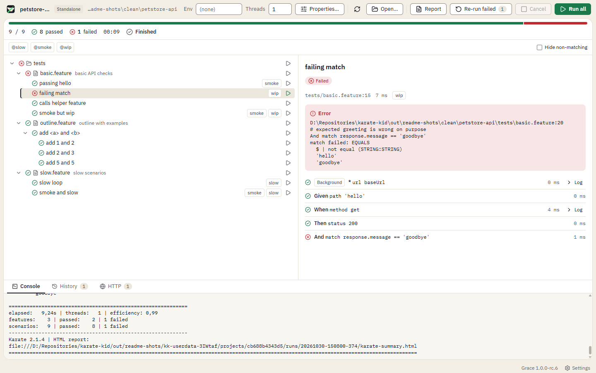
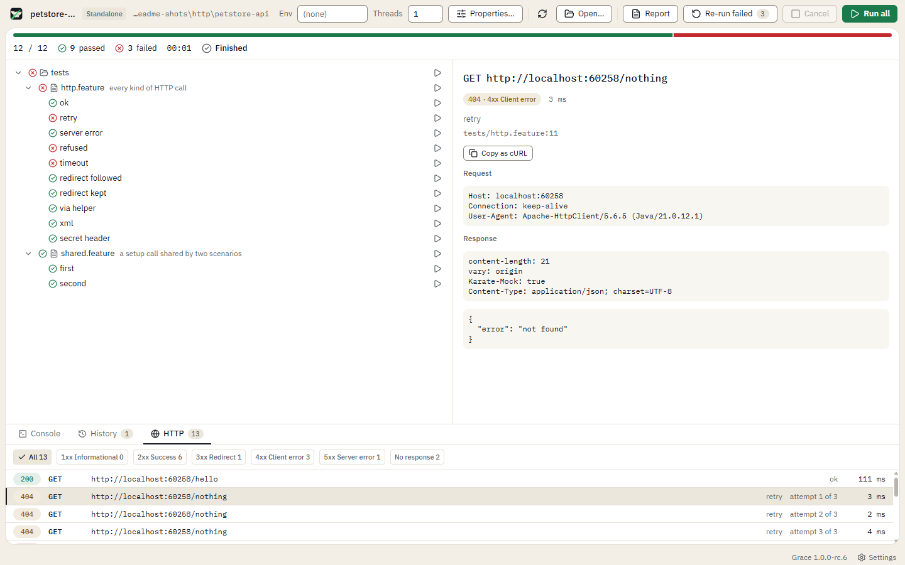
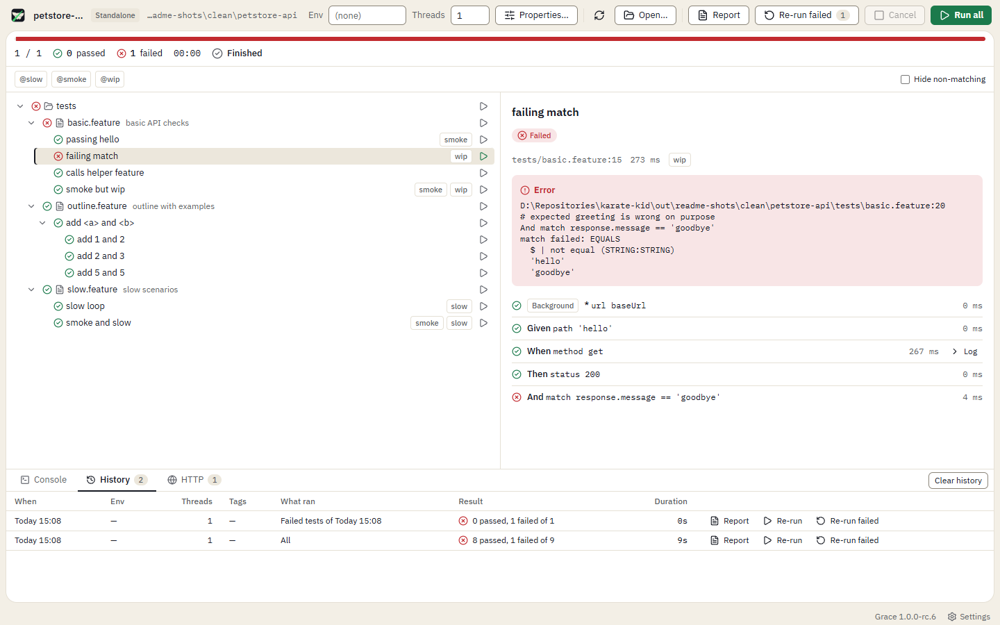
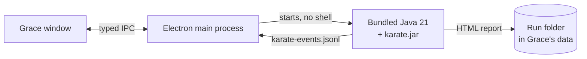

<div align="center">


# Grace

### The free desktop test runner for Karate

Open a folder of [Karate](https://docs.karatelabs.io/) v2 tests, pick what to run, and watch it run.<br>
Every scenario, every failed step and every HTTP call, in one window.

[](LICENSE)
[](#get-started)
[](https://docs.karatelabs.io/)
[](#how-it-works)
[](https://github.com/hpagniez/grace/releases)

[Get started](#get-started) · [Features](#features) · [How it works](#how-it-works) · [Roadmap](#roadmap) · [Build from source](#build-from-source)

</div>

<br>

<picture>
  <source media="(prefers-color-scheme: dark)" srcset="docs/images/run-dark.png">
  
</picture>

## Why Grace

Karate Labs sells its GUI runners. The Karate engine is open source, and its command line already does what a runner needs: it finds the tests, runs them in parallel, writes a live event stream and an HTML report. Grace is a desktop app on top of that command line.

- **Free, MIT licence.** No account, no licence key, no trial, no telemetry.
- **Nothing else to install.** A Java 21 runtime and the Karate jar ship inside the zip. Grace never uses the Java on your machine.
- **Your project stays clean.** Run output, history and reports go to Grace's own data folder, not into your project.

## Features

<table>
<tr>
<td width="50%" valign="top">

**Test tree**<br>
Folders, features, scenarios and each row of an outline's examples, found by a Karate dry run. Maven, Gradle and standalone layouts.

</td>
<td width="50%" valign="top">

**Run anything**<br>
The whole suite, a folder, a feature, one scenario or one example row. Cancel a run at any time.

</td>
</tr>
<tr>
<td valign="top">

**Tags**<br>
Click a tag to include it, click again to exclude it. Dim or hide the tests that do not match. Saved per project.

</td>
<td valign="top">

**Environments and secrets**<br>
Switch `karate.env` and set run properties per environment. Secret values are encrypted with your Windows account.

</td>
</tr>
<tr>
<td valign="top">

**Parallel runs**<br>
1 to 32 threads, saved per project and shown in the history.

</td>
<td valign="top">

**Live progress and console**<br>
Pass or fail on every node as the run goes, a progress bar, and Karate's log with errors and warnings in colour.

</td>
</tr>
<tr>
<td valign="top">

**Failure details**<br>
The error, the file and line, and every step with its time and log.

</td>
<td valign="top">

**HTTP inspector**<br>
Every call of the run, grouped by status class. Headers, bodies as pretty JSON or XML, timing, retries. Copy any call as cURL.

</td>
</tr>
<tr>
<td valign="top">

**History and reports**<br>
The last 20 runs of each project. Open Karate's HTML report of any of them, re-run a run on its environment and tags, or re-run only what failed.

</td>
<td valign="top">

**Flaky tests**<br>
A test that passed in one run and failed in another, with the same project files and environment, gets a flaky mark and the runs that prove it.

</td>
</tr>
<tr>
<td valign="top">

**Updates in the app**<br>
Grace checks for a new version at startup. Update in one click, or let Grace update itself. Your data is backed up first, and you can roll back to an earlier version.

</td>
<td valign="top">

**Made for long sessions**<br>
A home screen with your recent folders, light and dark themes that follow Windows or your choice, resizable panels, and a window that opens where you left it.

</td>
</tr>
</table>

### Every HTTP call, by status

<picture>
  <source media="(prefers-color-scheme: dark)" srcset="docs/images/http-dark.png">
  
</picture>

### History and re-runs

<picture>
  <source media="(prefers-color-scheme: dark)" srcset="docs/images/history-dark.png">
  
</picture>

## Get started

1. Download `Grace-win32-x64-<version>.zip` from the [latest release](https://github.com/hpagniez/grace/releases).
2. Unzip it anywhere and start `Grace.exe`.
3. Click **Open folder…** and pick a folder that holds Karate `.feature` files.

Grace runs on Windows 11 (x64). The app is not code-signed yet, so Windows SmartScreen can stop the first start: click **More info**, then **Run anyway**.

> [!NOTE]
> Every version is a release candidate of 1.0.0 for now. From 1.0.0-rc.6, Grace updates itself: click **Update** in the status bar, or open **Settings › Updates**. On 1.0.0-rc.5 or older, download the new zip instead. Settings and run history from an older release candidate may not carry over.

## How it works

Grace drives the open-source Karate command line. It does not patch or replace Karate.



1. **Discover.** A dry run lists every scenario and its tags without running them.
2. **Run.** Grace starts Karate with your selection, tags, environment and thread count.
3. **Follow.** Grace reads Karate's event stream as it is written, for live progress, and its output, for the console.
4. **Inspect.** After the run, Grace reads the HTTP calls from the step logs and keeps the run folder for the history.

[docs/inventory/karate-core.md](docs/inventory/karate-core.md) lists every open-source Karate v2 feature and how Grace uses it.

## Roadmap

Next on the list:

- **Project setup** for Maven, Gradle, a standalone jar and the Karate CLI ([#64](https://github.com/hpagniez/grace/issues/64)).
- **Step debugger**: breakpoints on steps, step over, inspect variables ([#65](https://github.com/hpagniez/grace/issues/65)).
- **Big projects**: smooth runs with thousands of tests ([#123](https://github.com/hpagniez/grace/issues/123), [#124](https://github.com/hpagniez/grace/issues/124), [#125](https://github.com/hpagniez/grace/issues/125)).
- **Keyboard navigation** in the test tree and the HTTP list ([#91](https://github.com/hpagniez/grace/issues/91)).

The full backlog is one [issue](https://github.com/hpagniez/grace/issues) per feature, on the [Grace project](https://github.com/users/hpagniez/projects/2) board.

## Build from source

You need Windows 11 and Node 24.

```bash
npm install
npm run vendor
npm start
```

`npm run vendor` downloads the bundled Java runtime and Karate jar, once.

| Command | What it does |
|---|---|
| `npm start` | Run the app in dev mode |
| `npm test` | Unit tests (Vitest) |
| `npm run e2e` | Package the app, then run the Playwright end-to-end tests |
| `npm run make` | Build the Windows zip in `out/make/zip/win32/x64/` |

Grace is built with Electron, SolidJS 2, TanStack Router and Tailwind CSS v4.

## Built by AI agents

AI coding agents write most of this repository. Each feature starts as a spec with acceptance criteria in [docs/specs/](docs/specs/), each hard-to-reverse choice gets a decision record in [docs/decisions/](docs/decisions/), and each packaged release is checked and recorded in [docs/checks/](docs/checks/). [AGENTS.md](AGENTS.md) is the agents' brief: the commands, the git flow and the rules for driving Karate.

## The name

Grace is named after Grace Hopper, whose team taped a moth into a logbook in 1947 as the "first actual case of bug being found".

## Licence

Grace is under the [MIT licence](LICENSE).

Grace is not affiliated with or endorsed by Karate Labs Inc. Karate is a trademark of Karate Labs Inc.

## Bundled software

The Windows zip bundles programs that are not part of Grace, each under its own licence:

- [Electron](https://www.electronjs.org/), with Chromium and Node.js. The `LICENSE` and `LICENSES.chromium.html` files next to `Grace.exe` are Electron's.
- The [Eclipse Temurin](https://adoptium.net/) Java runtime, under the GPLv2 with the Classpath Exception; licence texts in `resources/licenses/temurin`. Its source is the repository and commit named by `SOURCE_REPO` and `SOURCE` in `resources/jre/release`.
- [Karate](https://github.com/karatelabs/karate), under the MIT licence in `resources/licenses/karate-LICENSE.txt`. The libraries inside `karate.jar` keep their own licences, in the jar's `META-INF`.
