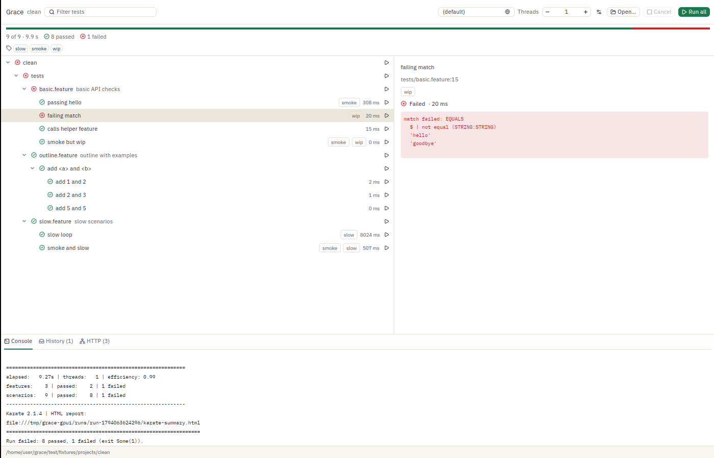
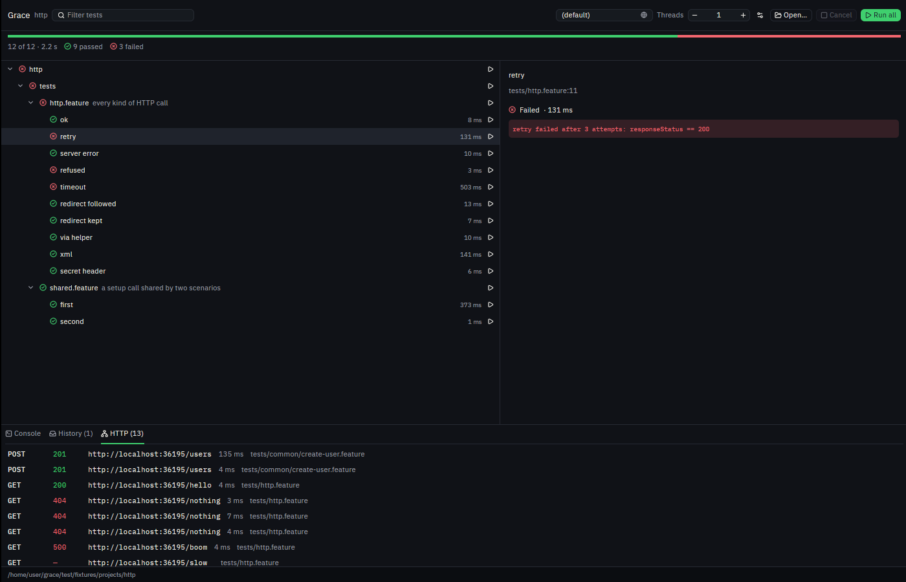
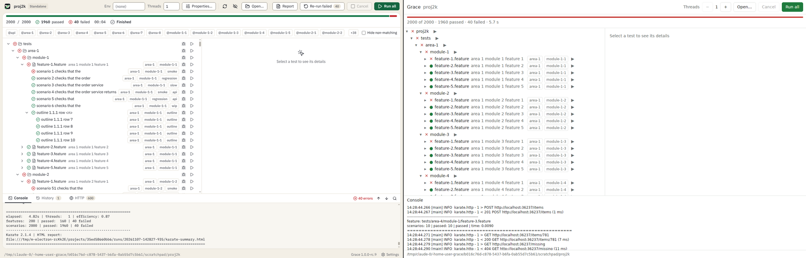

# GPUI prototype: Grace's main screen in Rust and GPUI, measured against Grace on Linux (#152)

Date 2026-11-07. A cloud Linux machine: Intel Xeon at 2.10 GHz, 4 vCPU, 17 GB, no GPU, Ubuntu 24.04, Xvfb 21.1 at 1920 x 1080. Grace: `develop` at `dc88524` (1.0.0-rc.9, Electron 45.1.0), packaged for Linux with a two-line patch ([below](#what-was-built)). The prototype: `gpui-pre` 0.3.11 (a snapshot of Zed's GPUI, `zed@f816e1f`), Rust 1.97. Both run the same Karate 2.1.4 jar on the same OpenJDK 21.0.12.

This follows the [desk study](../2026-11-07-gpui.md). It is a reference only: not in the build, not in CI, and `target/` is not kept.

## Final verdict (2026-11-08): GPUI wins on Windows, with the idle patch

The 5-round run on the reference machine (Windows 11, Ryzen 7 5800X, RTX 4060 Ti at 120 Hz), unpatched GPUI against Grace `1bcfdcd` ([results/windows-gpu-under-load.md](results/windows-gpu-under-load.md)). The PC was in use during the run (a video stream and other work), so the idle CPU rows are noisy; memory, size and run figures are steady across rounds.

| Measure, median of 5 | Grace | GPUI | Grace's limit |
|---|---|---|---|
| Idle memory, whole tree | 167 MB | 28 MB | 163 MB |
| Run all, peak app memory (2,000 / 10,000 tests) | 249 / 671 MB | 34 / 40 MB | 322 / 607 MB |
| Run all, app CPU (2,000 / 10,000 tests) | 3.6 / 14.2 s | 0.3 / 1.3 s | 5.4 / 17.7 s |
| Run all, wall time (2,000 / 10,000 tests) | 5.8 / 17.8 s | 4.1 / 12.3 s | |
| First paint, profile reused | 497 ms | 325 ms | 612 ms |
| Wheel during Run all: 95th percentile / longest frame | 8.4 / 8.4 ms | 9.1 / 9.7 ms | |
| Unpacked size, Java included | 489 MB | 192 MB | 489 MB |
| Idle CPU a minute, shown | 172 ms | 422 ms | 1,453 ms |
| Idle CPU a minute, minimised | 47 ms | 891 ms | 125 ms |

What this decides, by the priorities of [ADR 0023](../../decisions/0023-run-lightly-as-a-release-requirement.md):

1. **Run lightly: GPUI wins, once patched.** It uses a sixth of Grace's memory idle and a seventeenth during a 10,000-test run, and a tenth of its app CPU during runs. Java costs the same in both. Shown, it idles inside the ADR 0030 budget. Smoothness holds: with a GPU it draws at the screen's rate, idle and during Run all (9.7 ms at worst against an 8.3 ms frame; [results/windows-scroll.md](results/windows-scroll.md)). The one gap was **minimised**: unpatched, GPUI's vsync thread keeps drawing (891 ms a minute against the 125 ms limit, [zed#66221](https://github.com/zed-industries/zed/issues/66221)). The 74-line idle patch fixes it: 0 and 47 ms a minute minimised, and a restored or second window draws within 100 ms. About 61 wake-ups a second remain, but they all come from one thread of the NVIDIA D3D11 driver, which any D3D11 device starts, with or without a window: packaged Grace's GPU process has the same thread at 92 a second. Without it, the patched prototype wakes 0.0 to 0.1 times a second minimised. Nothing on that driver can pass the runbook's under-5 gate, Grace included; ADR 0030 counts what the runtime does by itself against the CPU limit, which the patch passes ([results/windows-idle-patch.md](results/windows-idle-patch.md#where-the-wake-ups-come-from)). Only NVIDIA was tested.
2. **Be fast: GPUI wins.** First paint in two thirds of Grace's time, the 2,000-test tree about as fast, and Run all a third quicker end to end.
3. **Be small: GPUI wins.** A 27 MB exe against 250 MB, 192 MB unpacked with Java against 489 MB.

**Recommendation: go for a migration, with the Windows idle patch.** Every gate passes on Windows once it is applied, and the wake-ups left are the GPU driver's, which Grace has too. The patch is a fork of a pre-1.0 framework, so it is better upstream ([zed#66221](https://github.com/zed-industries/zed/issues/66221); [patches/](patches/README.md#upstream)); until then, Grace would carry it. The decision itself is the owner's, and a go needs a decision record that supersedes ADR 0001, ADR 0004 and ADR 0005. Not covered yet: accessibility on Windows (#269 did Linux), a GPU reset, windows across screens with different refresh rates, another GPU vendor than NVIDIA, shown idle CPU with the cut patch, and showing a window again after hiding it.

Earlier readings: one quick round first ([results/windows-gpu-quick.md](results/windows-gpu-quick.md)), whose slow scrolling was a fault in the wheel probe, fixed in `b3dfddd`. The Linux wheel figures below used the old probe, so their GPUI column partly measures the gap between notches.

## Linux verdict, after the complete MVP (2026-11-07, evening)

On Linux, the complete MVP with the idle patch is lighter than Grace on every measure except smoothness without a GPU. With the patch it idles at zero, like an empty Electron window; without it, at Grace's own 220 to 230 ms a minute. That changes the morning's verdict: idle CPU was the reason for a no-go that did not depend on the platform, and on Linux it is gone. Two weak points remain, and neither is decided here:

1. **Smoothness needs a GPU.** GPUI redraws the whole window every frame, and llvmpipe rasterises it on the CPU here.
2. **The idle fix is a patch to GPUI, and is now optional.** [ADR 0030](../../decisions/0030-no-wake-ups-while-hidden-and-an-idle-cpu-budget.md) ([#276](https://github.com/hpagniez/grace/issues/276)) replaced "idle costs nothing" with two rules: no wake-ups while the window is minimised or hidden, and a CPU budget (the `idle.cpu.shown` limit) while it is shown. Unpatched, the MVP idles shown at 220 ms a minute, as Grace does today (230 ms), well inside that budget, so the shown half of the patch is no longer required. The hidden half still matters. On X11, GPUI already drops its refresh timer while a window is hidden. On Windows, read but not run, the vsync thread keeps waking on every vsync while the window is minimised, which the new rule does not allow; the Windows patch is what fixes it ([patches/](patches/README.md)). Measured since with a window manager ([results/hidden-idle-linux.md](results/hidden-idle-linux.md)): on X11, minimised and on another workspace, the MVP idles at 10 to 20 ms a minute and 4 wake-ups a second with or without the patch, as Grace does, so it meets ADR 0030 there. Covered by another window, unpatched GPUI keeps drawing at 66 wake-ups a second (220 ms a minute), because its window never hears that it is covered; Grace drops to 10 ms. Windows still has to be measured: the [Windows runbook](windows-runbook.md), step 3. Rather than keep a fork of a pre-1.0 framework, the better path is upstream, and both halves are already there: an open draft PR for X11 ([zed#66449](https://github.com/zed-industries/zed/pull/66449)) and an open issue for the minimised Windows window ([zed#66221](https://github.com/zed-industries/zed/issues/66221)); see [patches/](patches/README.md#upstream). Nothing has been posted there. The patch also cut the app's CPU during Run all from 3,470 ms to 2,630 ms, a gain that upstreaming would keep.

Grace ships on Windows, so a migration still needed the Windows measurement (#267); it is in the [final verdict](#final-verdict-2026-11-08-gpui-wins-on-windows-except-while-minimised) above.

| Median of 5 rounds [range] | Grace (Electron) | GPUI MVP, idle patch | First prototype (morning) |
|---|---|---|---|
| First paint | 312 ms [251–313] | **143 ms** [126–145] | 143 ms |
| Tree shown, 2,000 tests | 1,684 ms [1,636–1,782] | **1,582 ms** [1,499–1,648] | 1,523 ms |
| Idle memory (USS, app) | 198.6 MB, 6 processes | **161.2 MB**, 1 process | 145.4 MB |
| Idle CPU, shown, over 60 s | 230 ms [200–250] | **10 ms** [0–10] | 250 ms |
| Run all: peak memory, app | 351.0 MB | **169.7 MB** | 154.6 MB |
| Run all: CPU, app | 3,140 ms | **2,630 ms** | 2,460 ms |
| Run all: CPU, Java | 11,160 ms | 9,730 ms | 9,970 ms |
| Run all: wall time | 6,134 ms | **4,791 ms** | 4,720 ms |
| Wheel over the tree, idle: longest frame | **16.8 ms** | 47.2 ms | 47.7 ms |
| Wheel during Run all: longest frame | **33.4 ms** | 125.8 ms | 144 ms |
| Wheel during Run all: 95th percentile | **16.8 ms** | 64.5 ms | 95 ms |
| Size, unpacked, without Java | 279.3 MB | **40.5 MB** (one exe) | 25.5 MB |
| Empty window: idle memory / CPU | 155 MB / 0–40 ms | **129 MB / 10–20 ms** | 125 MB / 250–350 ms |

What the full MVP cost, compared with the morning's prototype: 16 MB of idle memory, 15 MB of exe (GPUI Kit, 135 more crates, and 0.8 MB of fonts), and nothing at idle. The idle patch also cut the app's CPU during Run all from 3,470 ms to 2,630 ms, because GPUI no longer redraws between batches. The same MVP without the patch idled at 220 ms a minute ([results/measure-mvp-unpatched.json](results/measure-mvp-unpatched.json), 3 rounds).

Raw results: [results/measure-mvp.json](results/measure-mvp.json), [results/fluid-mvp.json](results/fluid-mvp.json), [results/floor-mvp.log](results/floor-mvp.log). Same machine and method as [below](#how-it-was-measured), built with the [idle patch](patches/README.md):

```bash
sh patches/apply.sh
cargo build --release --config 'patch.crates-io.gpui-pre-linux.path="patches/vendor/gpui-pre-linux"'
```

### What the MVP adds (#270)

Built on [GPUI Kit](https://github.com/longbridge/gpui-component) (`gpui-component` 0.9.0, which pins the same `gpui-pre` 0.3.11), in about 2,200 lines with the tests:

- **Grace's look** ([src/look.rs](src/look.rs)): IBM Plex Sans and Mono embedded (TTF from Google Fonts' copy, OFL), the Lucide icons Grace uses, and the light and dark themes mapped from `src/index.css`'s tokens onto GPUI Kit's theme. The theme follows the system's, or `GRACE_THEME=light|dark`.
- **Inputs:** a filter box that narrows the tree as you type (a feature's name shows all its tests), an environment picker filled from the project's `karate-config-<env>.js` files and passed as `-e`, and a Threads number field.
- **A tag bar.** A chosen tag narrows the tree and turns Run all into Run tagged, with `-t @a,@b`, as the Karate CLI does.
- **Dialogs:** Properties, with an environment list and name and value rows (in memory only), and a confirm dialog before Cancel.
- **Selectable text** in the console (one selection across rows), the test's name, file and error.
- **The console follows its end** unless you scrolled up.
- **Bottom tabs:** Console, History (one row per finished run), and HTTP (method, status, URL, time and feature of every call, read from the step logs in `FEATURE_EXIT` events, as `http.ts` does).
- **The progress bar** split into passed and failed.
- **Accessibility props** that [#269](https://github.com/hpagniez/grace/issues/269)'s AT-SPI dump found missing: rows carry their status and selected state, the progress bar is a `ProgressIndicator` with its value, and the summary is a `Status`. Level and expanded are set too, but they don't reach AT-SPI ([below](#tests)).





How it went: GPUI Kit covered every missing piece. Its input, select, number field, dialog, alert dialog, tabs, buttons, tooltips and selectable text all worked on the first build, and no widget had to be written by hand. Most of the effort went into reading its API, which is large and still moving (its README already names a newer umbrella crate, `gpui-kit` 0.7). Two traps:

- A theme edited through `Theme::global_mut` does not reach the buttons. It has to go through `Theme::update`, which rebuilds the tokens the components read.
- The icon enum that `gpui_component` exports holds only the icons its own components use. Grace's icons come from `gpui_kit_assets::IconName`, embedded one by one with `icon_assets!`.

What is still missing compared with Grace: the step debugger, the report, settings, the updater, secrets, flaky-test proof, history charts, the HTTP inspector's detail panes, find in the console, and real persistence.

### Tests

11 tests pass in about 11 s (`cargo test`, with the real Karate for the last one):

- 6 unit tests on the repo's own event fixtures. New ones: the HTTP calls of `run-http.jsonl`, and the environments of the `env` project.
- 5 headless UI tests. New ones: typing in the filter box narrows the tree, and Cancel opens a dialog without cancelling.
- The port of `run.spec.ts`, which now also checks the History row.

**Accessibility and an e2e test through it** ([a11y-linux/](a11y-linux/README.md), #269's Linux half):

- **The e2e test passes through the accessibility tree.** [a11y-linux/e2e_run_all.py](a11y-linux/e2e_run_all.py) ports `run.spec.ts` "Run all with live progress" to AT-SPI, with the real Karate. It uses roles, names, descriptions, values and announcements, with no pixels and no coordinates. It passed 3 runs of 3, in about 11 s each, so it can replace Playwright for flows like this one. It can only check what was put in the tree by hand, though, and nothing fails when a label is forgotten.
- **Announcements work**, through a 90-line element ([src/a11y.rs](src/a11y.rs)), because GPUI's `div` has no live region. A screen reader hears "Running 9 tests", then "Run failed: 8 passed, 1 failed".
- **It costs nothing measurable.** On the 2,000-test project, with accessibility on and a client listening to every event, memory, CPU and run time all stayed inside the rounds' spread.
- **Two gaps depend on GPUI's pinned AccessKit AT-SPI adapter (0.19)**, and Grace cannot fix them itself:
  - A disabled button reads as enabled. AccessKit 0.21 fixes this, but GPUI has to move to it.
  - A tree row's open state and depth are set but not passed on. The chevron is therefore a button named "Open" or "Close".


## The morning's prototype

The rest of this page is the first prototype, before GPUI Kit and before the idle patch. Its numbers stand as measured. Where the evening's results change a conclusion, the verdict above wins.

### Verdict then: still no-go for a migration, and Windows decides

The prototype confirms the desk study, with numbers. GPUI is much lighter in memory, size and start. It is not lighter at idle, and without a GPU it is less smooth than Chromium. None of the numbers come from the reference machine, and the two weak points both depend on the platform, so they have to be measured on Windows with a real GPU before anyone decides.

- **Lighter, by a lot.**
  - Idle memory: 145 MB in 1 process against 210 MB in 6.
  - Peak app memory during Run all on 2,000 tests: 155 MB against 352 MB.
  - About 60 MB of GPUI's figure is the software renderer, which a GPU machine does not load.
  - Size without Java: 25 MB against 279 MB.
- **Faster.** First paint 143 ms against 305 ms. The tree shows at 1.52 s against 1.80 s; the Karate dry run is most of both. Run all finished in 4.7 s against 6.5 s, because Java got the CPU that Electron's renderer used.
- **Not idle.** Both used about 0.24 s of CPU a minute, shown and idle. GPUI's is structural: its X11 backend wakes every 16 ms while the window is visible, and its Windows backend runs a thread that waits on every vsync and redraws every visible window ([Idle](#idle)). Electron's is Grace's page: an empty Electron window used 0 to 10 ms a minute, an empty GPUI window 250 to 350 ms.
- **Smooth only with a GPU.** While the wheel scrolled the tree, Electron kept 60 fps and GPUI drew about 30 fps. During a run, GPUI's longest frame was 145 ms against Electron's 50 ms. GPUI redraws the whole window every frame, and here the CPU rasterised it (llvmpipe). Grace on a VM or a remote desktop without a GPU would get this.
- **Testable without a browser.** 7 tests pass in 11 s: unit tests on the repo's own event fixtures, headless UI tests, and a port of e2e `run.spec.ts` "Run all with live progress". That last test clicks Run all in a headless window and runs the real Karate ([Testability](#testability)).
- **Slower to build.** A one-line change rebuilds the tests in 2.5 s and a release in 78 s. A cold debug build takes about 2 minutes on 4 cores.

### What was built

[src/main.rs](src/main.rs) and [src/karate.rs](src/karate.rs), about 1,100 lines with the tests, written in one afternoon:

- Open a project (argument, `Open…` with the native folder picker, or `Ctrl+O`), and list its tests from a Karate dry run. The ported `buildArgs` and `buildTree` (folder > feature > scenario | outline > row) keep Grace's Karate rules: no shell, the four option variables removed, `cwd` the project root, depth-0 events only, tests keyed by feature + `refId`, `skipped` before `passed`.
- A virtual tree (`uniform_list`) with open and close, status marks rolled up to folders, tags, and ▶ on every node to run it alone.
- Run all (`Ctrl+Enter`) with live progress. `karate-events.jsonl` is tailed every 100 ms during a run only, as `runner.ts` does, and applied in one batch per 100 ms. There is also Cancel (`Escape`), a Threads stepper, the selected test's details with its error, the Karate console (the last 400 lines) and a status bar.
- Roles and labels for AccessKit on the window, buttons and tree rows.

Not built: filters, environments, properties, history, HTTP inspector, debugger, report, settings, theme, updater, secrets, and the Windows build.

Grace was packaged with `npm run package` on Linux after two changes, kept in [grace-linux.diff](grace-linux.diff): the classpath is joined with `path.delimiter` instead of `;`, and `vendor/jre/bin/java.exe` is a link to `java`. Grace is a Windows app; nothing else needed changing to open and run a project.

## How it was measured

[measure/measure.mjs](measure/measure.mjs) ports the parts of `bench/bench.mjs` that do not need Windows. Both apps ran under one Xvfb display, one at a time, alternating, 5 rounds after a warm-up, on the bench's own 2,000-test project (`writeBigProject(dir, 5)`).

- **Memory:** USS (private clean + private dirty pages, `/proc/<pid>/smaps_rollup`), the Linux match of Windows' private working set, summed over the app's process tree, Java apart.
- **CPU:** user + system time from `/proc/<pid>/stat`, for the same tree.
- **Start:** Electron's `first-contentful-paint` over CDP and the first tree row, as `startTimes`; the prototype prints the time of its first frame and of the first frame with the tree (`GRACE_PROBE`). Both are counted from the process spawn.
- **Idle:** a separate start with no CDP, 20 s to settle, then 60 s.
- **Run:** Run all clicked over CDP for Electron, and sent on stdin to the prototype. Peak memory is sampled every 250 ms; CPU is counted from the click to "Finished".
- **Rendering:** no GPU. Electron used SwiftShader, and GPUI used Mesa's llvmpipe Vulkan driver (LLVM 20.1). Both draw on the CPU here.

[measure/fluid.mjs](measure/fluid.mjs) is the frame probe: 60 wheel notches over the tree, one every 16 ms from `xdotool`, idle and 0.5 s into Run all, 5 rounds. Electron's frames are its `requestAnimationFrame` callbacks, the bench's own frame log. The prototype's frames are the frames in which its tree lays out rows. [measure/floor.mjs](measure/floor.mjs) measures each stack's empty 1400 x 900 window ([examples/floor.rs](examples/floor.rs) and [measure/electron-floor](measure/electron-floor/main.js)).

Raw results: [results/measure.json](results/measure.json), [results/fluid.json](results/fluid.json), [results/floor.log](results/floor.log).

## Results

Medians of 5 rounds after a warm-up; the range of the rounds in brackets.

| Measure | Grace (Electron) | GPUI prototype |
|---|---|---|
| First paint | 305 ms [252–316] | **143 ms** [119–177] |
| Tree shown, 2,000 tests | 1,804 ms [1,679–1,850] | **1,523 ms** [1,495–1,839] |
| Idle memory (USS, app) | 209.6 MB [209–210] | **145.4 MB** [145–146] |
| Processes | 6 | 1 |
| Idle CPU, shown, over 60 s | **230 ms** [230–240] | 250 ms [230–310] |
| Run all: peak memory, app | 352.1 MB [351–357] | **154.6 MB** [153–156] |
| Run all: peak memory, Java | 246.7 MB [197–254] | 242.4 MB [188–261] |
| Run all: CPU, app | 3,720 ms [3,230–3,930] | **2,460 ms** [2,210–2,490] |
| Run all: CPU, Java | 11,680 ms [10,920–12,290] | 9,970 ms [9,380–10,060] |
| Run all: wall time | 6,510 ms [6,094–6,925] | **4,720 ms** [4,611–4,916] |
| Memory after the run | 351.3 MB | **154.6 MB** |
| Size, unpacked, without Java | 279.3 MB | **25.5 MB** (one exe) |

Each stack's empty 1400 x 900 window, idle, 3 rounds ([results/floor.log](results/floor.log)):

| Empty window | Electron | GPUI |
|---|---|---|
| Idle memory (USS) | 154.4–155.0 MB, 6 processes | **125.1–125.4 MB**, 1 process |
| Idle CPU over 60 s | **0–10 ms** | 250–350 ms |

So Grace's own share is about 55 MB on Electron (210 − 155) and about 20 MB in the prototype (145 − 125). Most of GPUI's floor here is the software renderer ([below](#where-gpuis-memory-goes)). The CPU row is the clearest result of the day: an empty Electron window does nothing, while an empty GPUI window wakes 60 times a second. Grace's 0.23 s a minute on Electron comes from its page, not from Electron.

### Where GPUI's memory goes

Idle, by mapping (private pages): `libLLVM.so` 55 MB, the heap 22 MB, the exe 17 MB, Vulkan's shared buffers 14 MB, anonymous 9 MB, `libvulkan_lvp.so` 7 MB, other Vulkan drivers loaded by the ICD loader 4 MB. About 80 MB of the 145 MB belongs to software rendering, and a real GPU driver replaces it with its own, smaller share. Grace's own data (the tree, statuses, console) is in the 22 MB of heap.

### Idle

Neither app is at zero, and GPUI cannot get there without a change to GPUI.

- **GPUI on Linux:** `strace` of the idle prototype shows the main thread waking every 16 ms. The X11 backend starts a refresh timer at the screen's rate for every visible window (`start_refresh_loop` in `gpui_linux/src/linux/x11/client.rs`), and each tick asks the window whether it needs a frame. The timer stops only when the window is hidden.
- **GPUI on Windows** (read, not run): `gpui_windows/src/platform.rs` starts a `VSyncProvider` thread that loops on `DwmFlush` for as long as the app lives. On every vsync it calls `RedrawWindow(.., RDW_INVALIDATE)` on every visible, non-minimised window. That is 60 to 120 wake-ups a second, plus a `WM_PAINT` each time, in which GPUI checks for a change before it draws. Minimised, the thread keeps waking on every vsync but posts nothing. This matches the 0.86 % of a core that [egoist/mygo #1006](https://github.com/egoist/mygo/pull/1006) read for an idle GPUI window on Windows.
- **Electron:** the 0.23 s a minute is Chromium's own work for a page of about 2,300 nodes, as the [idle CPU note](../2026-10-31-idle-cpu-shown.md) found on Windows.

ADR 0023 says no timer runs while no run is going. With GPUI, Grace would have to carry a patch that stops the refresh loop while nothing is dirty, or get one upstream. Zed's own idle CPU depends on the same loop. (Since then, [ADR 0030](../../decisions/0030-no-wake-ups-while-hidden-and-an-idle-cpu-budget.md) allows a CPU budget while the window is shown, and keeps zero only while it is minimised or hidden: see the verdict above.)

### Fluidity

| Wheel over the tree, 60 notches in 1 s | Grace (Electron) | GPUI prototype |
|---|---|---|
| Idle: frames drawn | **78** (every vsync) | 32 |
| Idle: longest frame | **16.8 ms** | 47.7 ms |
| Idle: CPU while scrolling | **810 ms** | 2,730 ms |
| During Run all: longest frame | **50 ms** [33–67] | 144 ms [128–177] |
| During Run all: 95th percentile | **16.8 ms** | 95 ms [48–114] |

On this machine Electron is smoother. The CPU split explains why: during a 60-notch scroll, GPUI's own thread used 390 ms and llvmpipe's 4 raster threads 3.6 s. GPUI rebuilds and redraws the whole window on every frame and leaves rasterising to the GPU, which here is the CPU. Chromium scrolls a composited layer and rasterises only the rows that come into view. On a machine with a GPU, GPUI's own share should be all that is left: 390 ms for 60 frames, about 6.5 ms a frame here (measured in a separate, slower scroll of 60 notches, with the same per-thread split). That still has to be measured on the reference machine. People who run Grace in a VM, over Remote Desktop or on a GPU-less CI agent would get what this table shows.

### Size

The prototype is one 25.5 MB exe (stripped, thin LTO) that links `libxcb` and `libxkbcommon` and loads Vulkan at run time. Grace's Linux package without Java is 279.3 MB. Of that, Grace's own code (`app.asar`) is 0.5 MB, and the rest is Electron. On Windows the exe uses DirectX 11 and needs nothing beside it.

## Testability

What would replace Vitest and Playwright, tried in the prototype ([tests](src/main.rs) at the end of each file):

| Today | With GPUI | Tried here |
|---|---|---|
| Vitest `*.test.ts`: logic in Node | `cargo test`: plain `#[test]` functions | 4 tests of `karate.rs` on the repo's own fixtures (`test/fixtures/events/dryrun-clean.jsonl`, `1-normal-run-failure.jsonl`): the tree, keys, a live file read in two halves, the dry run's arguments |
| Vitest + Testing Library `*.test.tsx`: a component in jsdom | `#[gpui::test]` with `TestAppContext` and `VisualTestContext`: the real view, laid out and hit-tested on GPUI's test platform, no pixels and no window. Elements are found by `debug_selector` (the `data-testid` of GPUI), events are simulated, actions are dispatched, and the clock is fake | 2 tests: statuses roll up from fed events; closing a folder hides its rows |
| Playwright `_electron` e2e: the built app, the real Karate | The same `#[gpui::test]`, with the real Karate and `allow_parking`. It drives the whole app headless: click, wait for events, assert. What it does not cover is the real platform: the window, GPU, fonts, the native folder picker | 1 test, the port of `run.spec.ts` "Run all with live progress": 9 tests, 8 passed, 1 failed, `basic.feature` failed. It finishes in about 10 s |
| Playwright on the packaged exe | Nothing equivalent. Driving a real GPUI window from outside goes through the OS accessibility API (Windows UI Automation, through AccessKit), for example with FlaUI or the `uiautomation` crate. It sees only what has a role and a label | Tried in the evening on Linux through AT-SPI: a port of the Run all e2e test passes ([a11y-linux/](a11y-linux/README.md)) |
| The bench's CDP probes (`page.*`, click to paint, frames) | Probes built into the app behind a flag, as `GRACE_PROBE` here | First frame, tree shown, run start and end, frames |
| Screenshots (`npm run screens:readme`) | A screenshot of the real window from outside, or GPUI's own `screen-capture` feature | `import -window root` under Xvfb |

The headless layer is stronger than jsdom: it lays out and hit-tests the real elements, so a click lands where a person's would, and its fake clock removes waits. The outer layer is weaker. Grace's 30 e2e specs check the real window, menus, the folder picker, screens and theme through Playwright. With GPUI that is UI Automation, which is slower to write and to run, and only as good as the accessibility tree.

## UI quality and possibilities

Grace's [premium UI spec](../../specs/2026-10-29-premium-ui.md), requirement by requirement, against what GPUI 0.3.11 offers. The prototype tried the rows marked ✓.

| What Grace's spec asks | Electron + Solid + Tailwind today | GPUI | Notes |
|---|---|---|---|
| Semantic colour tokens, light and dark | CSS variables, `prefers-color-scheme` | A theme struct in Rust; `window.appearance()` gives light or dark | ✓ Both themes in the MVP, mapped onto GPUI Kit's theme; `palette.test.ts` and `tokens.test.ts` would become Rust tests |
| IBM Plex, bundled | `@fontsource` woff2 | `text_system().add_fonts()` with TTF or OTF | ✓ In the MVP, from Google Fonts' TTF copy (0.8 MB): fontsource ships only woff/woff2 |
| Lucide icons | `lucide` icon data, `Icon` | `svg()` with an asset source | ✓ In the MVP, from GPUI Kit's bundled Lucide set |
| Motion on transform, opacity, colour; none under reduced motion | CSS transitions, `prefers-reduced-motion` | `with_animation`, which honours `cx.reduce_motion()` | Equal |
| Shadows, rounded sheet, backdrop | CSS | Box shadows, corner radii; background blur only on the window | Equal for Grace's flat design (the spec has no glass) |
| Tooltips, popovers, menus, dialogs | `Tooltip`, the Popover API, native `<dialog>` | `tooltip()`, `anchored`, `deferred`; no dialog element | ✓ GPUI Kit's `Dialog` and `AlertDialog` in the MVP |
| Text inputs (filter, env, properties) | `<input>`, `<datalist>` | **None in GPUI**. Its own `input.rs` example builds a text field in 920 lines. GPUI Kit has `Input` | ✓ GPUI Kit's `Input`, `Select` and `NumberInput` in the MVP: worked first time |
| Selecting and copying text (console, errors, HTTP bodies) | Free in the DOM | **None in GPUI core**. Zed builds its own; GPUI Kit has selectable text | ✓ GPUI Kit's `SelectableText` in the MVP: one selection across console rows |
| Cut text with a tooltip (`Cut`) | CSS `text-overflow` and a check | `truncate()`, `text_ellipsis()` | Equal |
| Virtual lists | Grace's own (`virtual-tree`) | `uniform_list`, `list` | ✓ Built in |
| Keyboard focus, focus ring, shortcuts | DOM focus, CSS | `FocusHandle`, `track_focus`, actions and key bindings | ✓ Shortcuts built; finer keymaps than the DOM |
| Screen reader | Chromium's accessibility tree, free | AccessKit roles, labels, states and actions, by hand on each element | ✓ Roles set; not read with a screen reader |
| WCAG contrast | Tokens | Tokens | Equal |
| Charts (trends) | Hand-made SVG | `canvas` and paths; GPUI Kit has charts | |
| Rendering Karate's HTML report | Opens in the browser | Opens in the browser | Same |
| Rich text, Markdown | The DOM | Hand-made, or GPUI Kit's Markdown | |

What GPUI adds: one process, a frame drawn on the GPU at the display's rate, no DOM to grow (Grace's 10,000-test page reaches 23,660 nodes), and real control over every frame. What it takes away: the browser's free text editing, text selection, form controls and accessibility, and the DevTools that agents and people use to inspect a page. Electron with Solid reaches the spec's look today. GPUI can reach it, but each piece Chromium gives for free has to be built or taken from GPUI Kit, a second pre-1.0 dependency.



Grace on Electron (left) and the prototype (right), the 2,000-test project after Run all, both at 1960 passed and 40 failed. The prototype has the same structure in a plain, system-font version of Grace's light theme, without Lucide icons, IBM Plex, the filter bar, the bottom panel's tabs, the split progress bar or the console's follow-the-end. That is an afternoon of work. The premium pass, done the GPUI way, is #270.

## What it meant for #152 (morning)

- **The gains are real and large** on memory, size and start: priorities 1 (memory part), 2 and 3 of ADR 0023.
- **Two risks are now concrete** and both sit inside priority 1. Idle CPU is non-zero by GPUI's design on every platform, and fluidity depends on a GPU.
- **The Windows run decides.** The [follow-up issues](#follow-up) build the prototype for Windows, measure it on the reference machine with a real GPU and with the GPU off (Basic Display Adapter, as in a VM), patch the idle loop, and check the accessibility tree with UI Automation.

## Follow-up

What is left to run on Windows, step by step with commands and go/no-go gates: [windows-runbook.md](windows-runbook.md).

Sub-issues of #152:

- [#267](https://github.com/hpagniez/grace/issues/267) (should): build the prototype for Windows and measure it on the reference machine, with the GPU and without it, and both floors. A one-command script is ready in [measure/windows/](measure/windows/README.md), not yet run; parked for now.
- [#268](https://github.com/hpagniez/grace/issues/268) (could): stop GPUI's refresh loop while nothing changes. Done for X11 the same day ([patches/](patches/README.md)); the Windows patch is written, not run. Optional since [ADR 0030](../../decisions/0030-no-wake-ups-while-hidden-and-an-idle-cpu-budget.md), except the Windows part that stops wake-ups while minimised; to be followed upstream ([zed#66449](https://github.com/zed-industries/zed/pull/66449), [zed#66221](https://github.com/zed-industries/zed/issues/66221)) rather than kept as a fork.
- [#269](https://github.com/hpagniez/grace/issues/269) (could): check the accessibility tree, and try one e2e test through UI Automation.
- [#270](https://github.com/hpagniez/grace/issues/270) (could): add text input, selectable text and dialogs with GPUI Kit, in Grace's look. Done the same evening ([above](#what-the-mvp-adds-270)).

Grace already ships only the `en-US` Chromium locale ([#150](https://github.com/hpagniez/grace/issues/150), PR #206: 12.6 MB less zipped, 50.6 MB less unpacked), and the measured package above includes that cut. #271 was closed as its duplicate.

If #267 ends in a go, a decision record superseding ADR 0001, 0004 and 0005 comes first, then a spec and a migration plan.

## Run it

```bash
# Linux: apt-get install libxkbcommon-x11-dev libxcb1-dev libvulkan1 mesa-vulkan-drivers xvfb xdotool
sh patches/apply.sh                                    # the idle patch (#268), then:
cargo build --release --config 'patch.crates-io.gpui-pre-linux.path="patches/vendor/gpui-pre-linux"'   # 40 MB
GRACE_JAVA=$(which java) GRACE_KARATE_JAR=../../../vendor/karate.jar target/release/grace-gpui <project>
GRACE_JAVA=$(which java) GRACE_KARATE_JAR=... cargo test   # 11 tests, the last one runs Karate
cargo build --release --example floor                  # the empty-window floor
# From a folder whose node_modules has playwright (a Grace checkout), with DISPLAY set:
node measure.mjs --electron <Grace> --gpui <grace-gpui> --project <dir> --java <java> --jar <karate.jar>
node fluid.mjs   (same flags)
node floor.mjs --electron-bin <electron> --gpui-floor target/release/examples/floor
```
